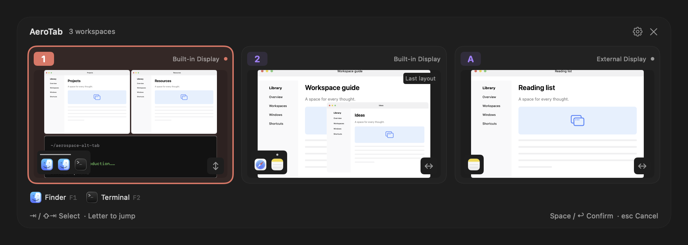
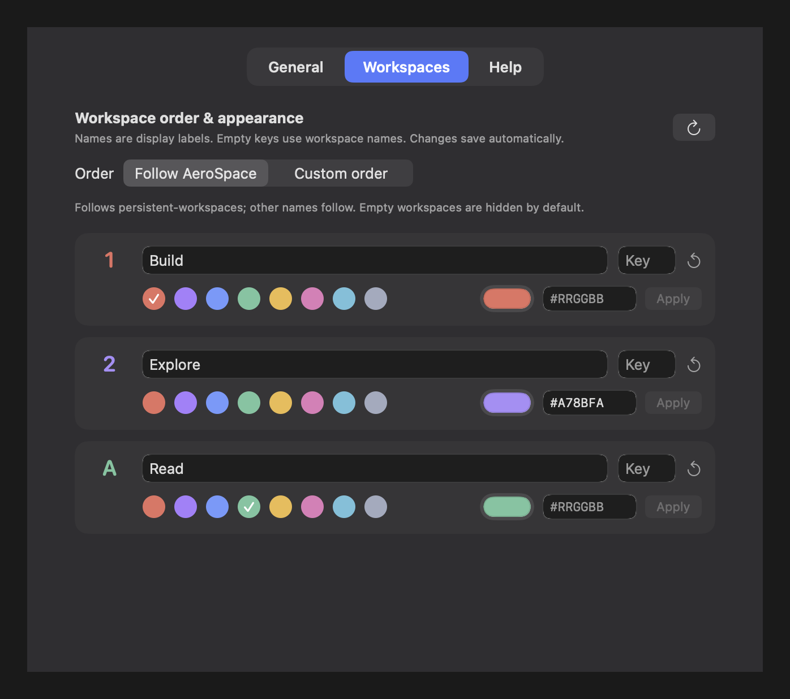

<div align="center">

# AeroTab

**See your workspaces. Find your windows. Jump straight in.**

A native workspace switcher for [AeroSpace](https://github.com/nikitabobko/AeroSpace), built with SwiftUI and AppKit.

English · [简体中文](README.zh-CN.md)


[](LICENSE)

</div>

<picture>
  <source media="(prefers-color-scheme: dark)" srcset="assets/demo/switcher-en-dark.png">
  <source media="(prefers-color-scheme: light)" srcset="assets/demo/switcher-en-light.png">
  
</picture>

## Why AeroTab?

AeroTab brings an Alt-Tab-style overview to **whole AeroSpace workspaces**. Press **⌥ Tab**, let go, and see which windows live where before you switch.

- **Small desktop previews** preserve window positions, sizes, and overlap.
- **One icon per window**, even when covered or uncapturable. Two Finder windows get two Finder icons.
- **Keyboard-first navigation** with workspace letters, Tab cycling, and configurable app shortcuts.
- **Layout hints** distinguish nested groups and floating windows at a glance.
- **Multiple displays**, stable workspace ordering, custom names, and HEX colors.
- **Static previews** refresh once when opened. A lightweight background is the default; Liquid Glass is optional.

## Install

Requires **macOS 26+** and **[AeroSpace](https://github.com/nikitabobko/AeroSpace) 0.21.3-Beta or later**, running on your Mac.

### Homebrew (recommended)

```sh
brew install --cask miraclexyz/tap/aerotab
```

Open AeroTab and follow the setup guide to enable **Accessibility**, plus **Screen Recording** for window-content previews. Then press **⌥ Tab**.

**Updating:** quit AeroTab, run the following commands, then reopen it:

```sh
brew update
brew upgrade --cask miraclexyz/tap/aerotab
```

If you previously installed the ZIP, quit AeroTab and move the old AeroTab.app from Applications to Trash before running the install command. Your settings are preserved.

### Manual download

1. Download from **[GitHub Releases](https://github.com/MiracleXYZ/AeroTab/releases/latest)**: choose `arm64.zip` for Apple Silicon or `x86_64.zip` for Intel.
2. Unzip and drag **AeroTab.app** into **Applications**, then open it.
3. Follow the setup guide to enable **Accessibility**. Enable **Screen Recording** too if you want window-content previews.
4. Press **⌥ Tab**. If AeroSpace or another app already uses this shortcut, unbind it first.

The app is not notarized. If macOS blocks it, follow [Apple’s instructions](https://support.apple.com/102445) to select **Open Anyway** in **System Settings → Privacy & Security**.

If **Open Anyway** is unavailable, and you trust the copy downloaded from this project's Releases, remove its quarantine flag in Terminal:

```sh
xattr -dr com.apple.quarantine "/Applications/AeroTab.app"
```

Then reopen AeroTab.

**Updating:** quit AeroTab, replace it in Applications, and reopen it. Settings are preserved; grant permissions again if macOS requests them.

## Use it

| Input | Action |
| --- | --- |
| **⌥ Tab** | Open the switcher at the current workspace; releasing Option keeps it open |
| **Tab / Shift-Tab** | Select the next / previous workspace |
| **Workspace letter or number** | Jump directly to that workspace |
| **Space / Return** | Enter the selected workspace |
| **Esc / click outside** | Cancel |
| **F1–F12** | Focus an app in the selected workspace, following the app row at the bottom |
| **Click a card / app** | Enter the workspace / app |
| **Right-click an app** | Choose a specific window |
| **⌘ , / gear button** | Open settings |

Arrow keys and repeated **⌥ Tab / ⌥ Shift-Tab** also move the selection. On keyboards with media keys, use **fn** with F1–F12, or customize the app keys.

Prefer the familiar hold-to-switch behavior? Enable **Hold ⌥ to switch** in **General**. It preselects the next workspace and commits when Option is released. This mode is off by default.

### Read the layout

The icons **inside the bottom-left corner of each preview represent windows**, ordered by the recorded layout. The separate app row below the cards groups windows by app for quick navigation.

| Mark | Meaning |
| --- | --- |
| Two matching icons | Two windows of the same app; neither is hidden from the list |
| Line over a group of icons | A nested layout group within the outer arrangement |
| Dot over an icon | A floating window; floating windows are listed after tiled windows |
| Direction symbol at bottom right | The outer tiled layout runs left–right or top–bottom; drawn with SF Symbols |

In workspace **1** above, the line joins the two Finder icons: their windows sit side by side above Terminal, so the outer direction is vertical. In workspace **2**, the dot marks the floating Notes window. For deeper nesting, the preview shows the full geometry while the line marks only the outer subgroup.

## Make it yours

Open **Settings…** from the menu bar, the switcher’s gear, or **⌘ ,** while the switcher is open. Reopening an already-running AeroTab also opens settings.

- **General → Language**: choose Follow system, English, or 简体中文. Changes apply immediately.
- **General → App shortcuts → Customize…**: edit up to 12 app keys. Defaults are F1–F12; letters such as Z/X/C/V, digits, and supported punctuation can be entered individually. Leave a slot blank to disable it. Workspace keys take priority; duplicate and invalid keys are disabled.
- **Workspaces**: set a display name, a direct-selection key, and a preset or custom HEX color (`#RGB` or `#RRGGBB`). Names only change AeroTab’s display labels.
- **Order**: follow the array order of AeroSpace’s `persistent-workspaces`, or arrange workspaces yourself. Unlisted workspaces are appended in natural name order. Empty workspaces are hidden by default.
- **Displays**: show all workspaces on the focused display, or each display’s own workspaces on that display.
- **Tab order**: use the workspace order, or most recently used order.

<details>
<summary>Workspace settings demo</summary>



</details>

Changes save automatically to `~/Library/Application Support/AeroTab/settings.json`. Common Homebrew CLI locations are detected; a different executable path can be set in **General → Connection & startup**.

## Layouts and privacy

AeroTab records window positions when a workspace is visible. Unvisited workspaces show “Layout not recorded”; hidden workspaces use the “Last layout”, updated when you visit them. Uncapturable windows still have icons.

Previews stay in local memory and are cleared when the switcher closes. Normal use does not save captures to disk. There is no telemetry or application network access.

## Development and maintenance

Requires **Swift 6** and Command Line Tools or Xcode with the **macOS 26 SDK**. There are no third-party Swift package dependencies.

```sh
python3 -m unittest discover -s scripts/tests
python3 scripts/check-localizations.py  # Check translation keys and arguments
./scripts/test.sh          # Run core tests
./scripts/build.sh         # Build build/AeroTab.app
./scripts/package.sh       # Package a Release ZIP for the current architecture
```

`AeroTabCore` handles the CLI, settings, layout, and keyboard routing; `AeroTab` handles the native interface, capture, and global keyboard input. English is the source language. Add matching keys to `Resources/en.lproj/Localizable.strings` and `Resources/zh-Hans.lproj/Localizable.strings`, keeping format arguments intact.

**Visual checks:** run `python3 scripts/audit-preview.py build/AeroTab.app/Contents/MacOS/AeroTab` to render fictional fixtures offscreen and check the test process’s effect on workspaces and focus. Temporary outputs are cleaned automatically; keep `build/` for installable packages. Curated README demos live in `assets/demo/`.

**Releases:** update the version and build number in `Resources/Info.plist` and the version badges in both READMEs, commit, then push the matching `vX.Y.Z` tag. The release workflow tests, builds, and packages on Apple Silicon and Intel runners, then creates a **draft GitHub Release** with both ZIPs and SHA-256 checksums. Inspect the assets, write the release notes, and publish from the Releases page. Publishing a stable release triggers the Homebrew workflow, which verifies both ZIPs and updates the [Homebrew tap](https://github.com/MiracleXYZ/homebrew-tap). Drafts and prereleases are excluded. To retry, use **Actions → Homebrew → Run workflow** with a published tag, or leave it blank for the latest stable release.

Sync uses the repository secret `HOMEBREW_TAP_DEPLOY_KEY`, an SSH deploy key with write access only to the tap repository. The cask template is `scripts/aerotab.rb.template`; the sync script is `scripts/update-homebrew.py`.

Builds use ad-hoc signing by default. Set `CODESIGN_IDENTITY` to use a local signing certificate; Developer ID notarization requires separate setup.

Issues and contributions are welcome. Include your macOS/AeroSpace versions and reproduction steps, and remove private information from screenshots.

## Inspired by

- [AeroSpace](https://github.com/nikitabobko/AeroSpace) — the workspace and window-management foundation.
- [alt-tab-macos](https://github.com/lwouis/alt-tab-macos) — inspiration for a visual, keyboard-driven switcher with window previews.

AeroTab is an independent project and is not affiliated with either project.

## License

[MIT](LICENSE) © 2026 MiracleXYZ.
