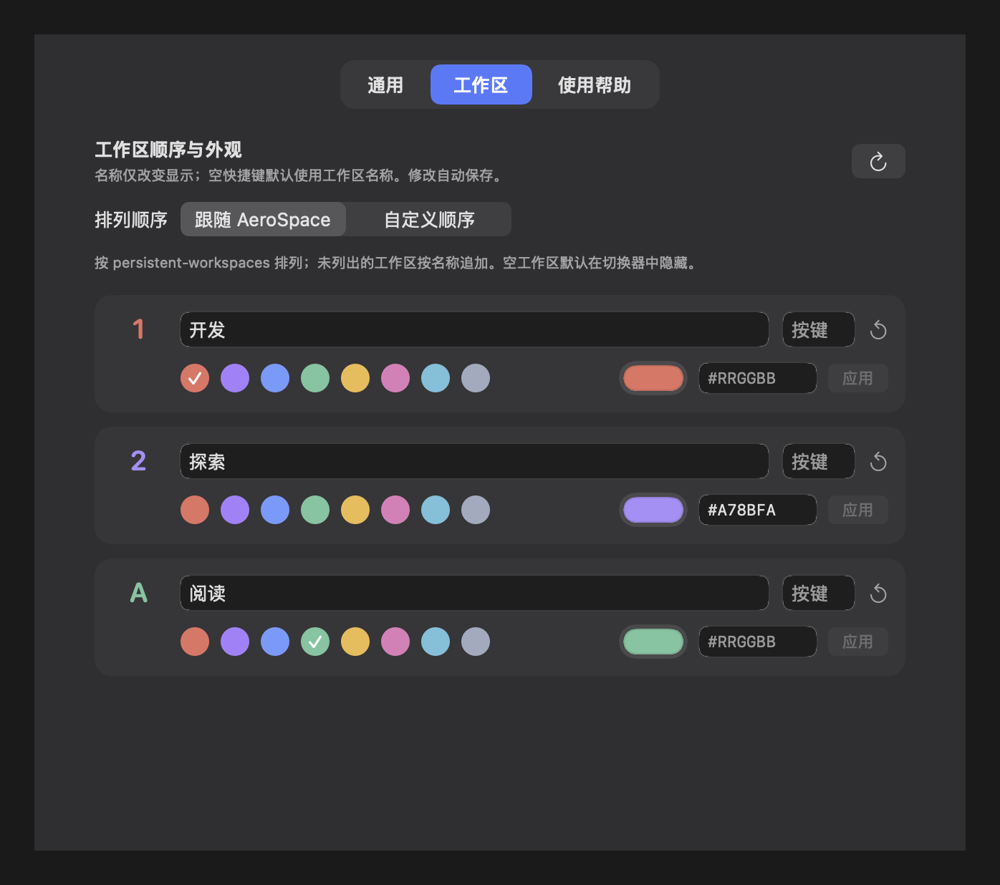

<div align="center">

# AeroTab

**看清工作区，找到窗口，直接切换。**

为 [AeroSpace](https://github.com/nikitabobko/AeroSpace) 打造的原生工作区切换器，使用 SwiftUI 与 AppKit 构建。

[English](README.md) · 简体中文


[](LICENSE)

</div>

<picture>
  <source media="(prefers-color-scheme: dark)" srcset="assets/demo/switcher-zh-dark.png">
  <source media="(prefers-color-scheme: light)" srcset="assets/demo/switcher-zh-light.png">
  
</picture>

## 为什么使用 AeroTab？

AeroTab 将 Alt-Tab 式的预览带到**整个 AeroSpace 工作区**。按下 **⌥ Tab** 后即可松手，先看清每个工作区里有哪些窗口，再决定去哪里。

- **小桌面预览**：保留窗口的相对位置、尺寸和叠放关系。
- **每个窗口一个图标**：遮挡或无法截图都不会漏掉；两个 Finder 窗口就显示两个 Finder 图标。
- **键盘操作**：工作区字母直达、Tab 循环选择、可自定义的应用快捷键。
- **布局提示**：用分组线、浮动圆点和方向符号帮助辨认布局。
- **多显示器与个性化**：固定工作区顺序、自定义名称及 HEX 颜色。
- **静态预览**：每次打开时更新一次；默认使用轻量背景，可选 Liquid Glass。

## 安装

需要 **macOS 26+**，以及已启动的 **[AeroSpace](https://github.com/nikitabobko/AeroSpace) 0.21.3-Beta 或更新版本**。

1. 从 **[GitHub Releases](https://github.com/MiracleXYZ/AeroTab/releases/latest)** 下载对应安装包：Apple 芯片选择 `arm64.zip`，Intel Mac 选择 `x86_64.zip`。
2. 解压，将 **AeroTab.app** 拖到 **Applications（应用程序）**，然后打开。
3. 按应用引导开启 **辅助功能** 权限；如需窗口内容预览，再开启 **屏幕录制** 权限。
4. 按 **⌥ Tab** 开始使用。如果 AeroSpace 或其他应用已占用该快捷键，请先取消对应绑定。

应用尚未公证。如果 macOS 阻止打开，可按 [Apple 的说明](https://support.apple.com/102445)，在 **系统设置 → 隐私与安全性** 中选择 **仍要打开**。

如果没有出现 **仍要打开**，且确认安装包来自本项目的 Releases 并信任其来源，可在终端移除隔离标记：

```sh
xattr -dr com.apple.quarantine "/Applications/AeroTab.app"
```

然后重新打开 AeroTab。

**更新：**退出 AeroTab，用新版替换 Applications 中的应用，再重新打开。设置会保留；如 macOS 要求，请重新授权。

## 使用方式

| 操作 | 行为 |
| --- | --- |
| **⌥ Tab** | 打开切换器，初始选中当前工作区；松开 Option 后保持显示 |
| **Tab / Shift-Tab** | 选择下一个 / 上一个工作区 |
| **工作区字母或数字** | 直接进入对应工作区 |
| **空格 / 回车** | 进入选中的工作区 |
| **Esc / 点击外部** | 取消 |
| **F1–F12** | 按面板底部应用列表的顺序，进入选中工作区的对应应用 |
| **点击卡片 / 应用** | 进入工作区 / 应用 |
| **右键应用** | 选择具体窗口 |
| **⌘ , / 齿轮按钮** | 打开设置 |

方向键和再次按 **⌥ Tab / ⌥ Shift-Tab** 也能移动选择。若键盘默认使用媒体键，请配合 **fn** 使用 F1–F12，或自定义应用快捷键。

喜欢按住 Option 的传统切换方式？在 **通用** 中开启 **按住 ⌥ 模式**，打开时会预选下一个工作区，松开 Option 即确认。此模式默认关闭。

### 看懂布局标记

每张预览**内部左下角的图标代表窗口**，按照已记录的布局排列。卡片下方的应用快捷键列表则按应用合并，方便快速进入应用。

| 标记 | 含义 |
| --- | --- |
| 两个相同图标 | 同一应用有两个窗口，都在列表中显示 |
| 一组图标上方的横线 | 最外层排列中的一个子布局组 |
| 图标上方的圆点 | 浮动窗口；统一排列在平铺窗口之后 |
| 右下角方向符号 | 最外层平铺布局为左右或上下排列，使用 SF Symbols 绘制 |

上图工作区 **1** 的两个 Finder 左右并排、终端在下方，因此横线覆盖两个 Finder 图标，最外层方向为上下。工作区 **2** 的圆点表示 Notes 是浮动窗口。更深层的嵌套通过预览查看，横线仅标出最外层的子组。

## 自定义

可以从菜单栏的 **设置…**、切换器齿轮或切换器内的 **⌘ ,** 进入设置。再次打开已经运行的 AeroTab 也会打开设置。

- **通用 → 语言**：选择跟随系统、English 或简体中文，切换立即生效。
- **通用 → 应用快捷键 → 自定义…**：分别填写最多 12 个位置的按键。默认 F1–F12，也可逐项输入 Z/X/C/V 等字母、数字或支持的标点。留空取消该位置的快捷键；工作区按键优先，重复或无效按键不会启用。
- **工作区**：设置显示名称、直达按键、预设色或自定义 HEX 颜色（`#RGB` / `#RRGGBB`）。名称仅改变 AeroTab 中的显示。
- **排列顺序**：默认遵循 AeroSpace 的 `persistent-workspaces` 数组顺序，也可自行调整。未列出的工作区按名称自然排序追加。默认隐藏空工作区。
- **多显示器布局**：在聚焦屏幕显示全部工作区，或在每块屏幕显示属于它的工作区。
- **Tab 循环顺序**：跟随工作区排列顺序，或选择最近使用优先。

<details>
<summary>展开查看工作区设置演示</summary>



</details>

修改自动保存在 `~/Library/Application Support/AeroTab/settings.json`。常见的 Homebrew CLI 安装位置会自动识别；其他路径可在 **通用 → 连接与启动** 中指定。

## 布局与隐私

AeroTab 在工作区可见时记录窗口位置。尚未访问过的工作区显示“布局待记录”；隐藏工作区显示“上次布局”，访问后更新。无法捕获的窗口仍显示图标。

预览只在本机内存中处理，关闭切换器后清除，不会在正常使用时保存到磁盘。没有遥测或应用网络请求。

## 开发与维护

需要 **Swift 6** 和包含 **macOS 26 SDK** 的 Command Line Tools 或 Xcode。无第三方 Swift 包依赖。

```sh
python3 scripts/check-localizations.py  # 检查翻译 key 与格式参数
./scripts/test.sh          # 运行核心测试
./scripts/build.sh         # 构建 build/AeroTab.app
./scripts/package.sh       # 打包当前架构的 Release ZIP
```

`AeroTabCore` 负责 CLI、配置、布局和按键路由；`AeroTab` 负责原生界面、窗口捕获与全局键盘处理。英文为源语言；新增文案时同步更新 `Resources/en.lproj/Localizable.strings` 与 `Resources/zh-Hans.lproj/Localizable.strings`，保持 key 和格式参数一致。

**界面检查：**运行 `python3 scripts/audit-preview.py build/AeroTab.app/Contents/MacOS/AeroTab`，使用虚构数据离屏渲染，并检查测试进程是否影响工作区和焦点。临时产物默认自动清理；`build/` 只保留安装包。README 演示图保存在 `assets/demo/`。

**发布版本：**更新 `Resources/Info.plist` 的版本号、构建号及两份 README 的版本徽章，提交后推送对应的 `vX.Y.Z` 标签。Release workflow 会在 Apple Silicon 与 Intel runner 上分别测试、构建并打包，创建带有两个 ZIP 和 SHA-256 校验文件的 **GitHub Release 草稿**。检查产物、填写版本说明后，在 Releases 页面发布。

默认构建使用 ad-hoc 签名。如需使用本机证书，可设置 `CODESIGN_IDENTITY` 环境变量；Developer ID 公证需另行配置。

欢迎提交问题与改进。问题报告请附 macOS / AeroSpace 版本和复现步骤，截图中请移除私人信息。

## 灵感来源

- [AeroSpace](https://github.com/nikitabobko/AeroSpace)：工作区与窗口管理基础。
- [alt-tab-macos](https://github.com/lwouis/alt-tab-macos)：带窗口预览、以键盘操作为核心的视觉切换体验。

AeroTab 是独立项目，与上述项目没有隶属关系。

## 许可

[MIT](LICENSE) © 2026 MiracleXYZ。
